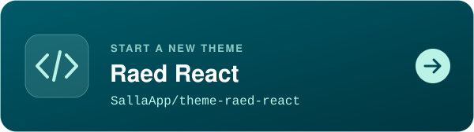
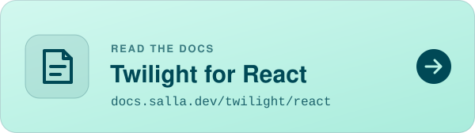

<a href="https://github.com/SallaApp/theme-raed-react">
  
</a>

> [!WARNING]
> **This repository is deprecated.** Theme Raed is now a React theme, built on Twilight for React. New Salla themes start from [SallaApp/theme-raed-react](https://github.com/SallaApp/theme-raed-react).

<p align="center">
  <a href="https://github.com/SallaApp/theme-raed-react"></a>
  <a href="https://docs.salla.dev/twilight/react"></a>
</p>

## Start a new theme

```bash
npm install -g @salla.sa/cli
salla theme doctor                     # checks Node, pnpm and git
salla theme create --name "My Store"   # scaffolds Raed React and starts the dev server
```

The storefront opens at `http://localhost:5173/en`, or `/ar` for Arabic. You don't need a Salla account to create and run a theme. The [quick start](https://docs.salla.dev/twilight/react/start/quick-start) walks through each step.

## Twig and React side by side

|                   | Twig (this repository)                                                    | React                                                                       |
| ----------------- | ------------------------------------------------------------------------- | --------------------------------------------------------------------------- |
| Status            | Deprecated                                                                | Active                                                                      |
| Repository        | `SallaApp/theme-raed`                                                     | [`SallaApp/theme-raed-react`](https://github.com/SallaApp/theme-raed-react) |
| Templates         | Twig views in `src/views`                                                 | React components in `app/`                                                  |
| Rendering         | The Salla Store renders the Twig                                          | Server-rendered with TanStack Start on Cloudflare Workers                   |
| Local development | `salla theme preview` on a demo store                                     | `salla theme dev`, with hot reload and no login                             |
| Docs              | [Twilight (Twig)](https://docs.salla.dev/?nav=01HNFTD5Y5ESFQS3P9MJ0721VM) | [Twilight for React](https://docs.salla.dev/twilight/react)                 |

## Where to go next

| Guide                                                                                | What it covers                                                                 |
| ------------------------------------------------------------------------------------ | ------------------------------------------------------------------------------ |
| [Quick start](https://docs.salla.dev/twilight/react/start/quick-start)               | Create a theme, run it locally and change one thing.                           |
| [Project structure](https://docs.salla.dev/twilight/react/start/project-structure)   | The few files a theme owns and what each one does.                             |
| [How it works](https://docs.salla.dev/twilight/react/start/how-it-works)             | What happens between a customer typing an address and a rendered page.         |
| [Settings](https://docs.salla.dev/twilight/react/guide/settings)                     | Declare merchant settings in `twilight.json` and read them in your components. |
| [Theme editor](https://docs.salla.dev/twilight/react/local-development/theme-editor) | Open the merchant theme editor around your local dev server.                   |
| [Publish](https://docs.salla.dev/twilight/react/local-development/publish)           | Push your theme to its repository and submit it for review.                    |
| [Build with AI](https://docs.salla.dev/twilight/react/start/build-with-ai)           | Give your coding assistant the Salla Partners agent kit and MCP.               |

## Need help?

Ask in the [Salla developers community on Telegram](https://t.me/salladev), or open an issue on [theme-raed-react](https://github.com/SallaApp/theme-raed-react/issues).
